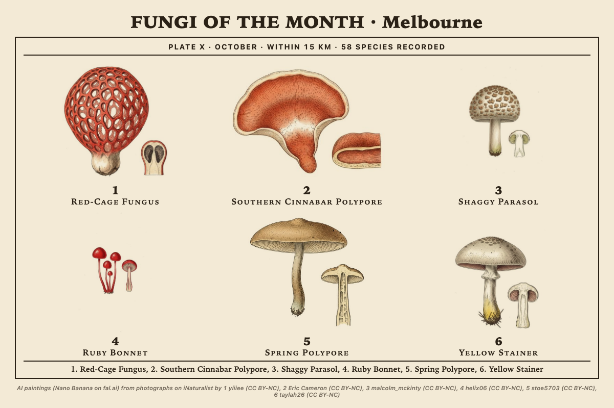
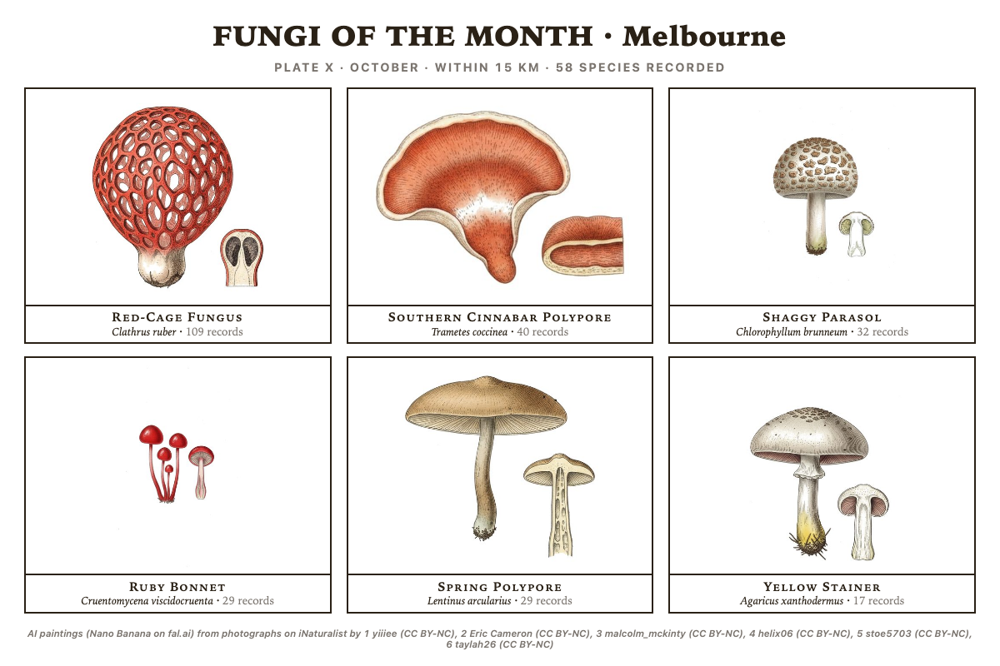
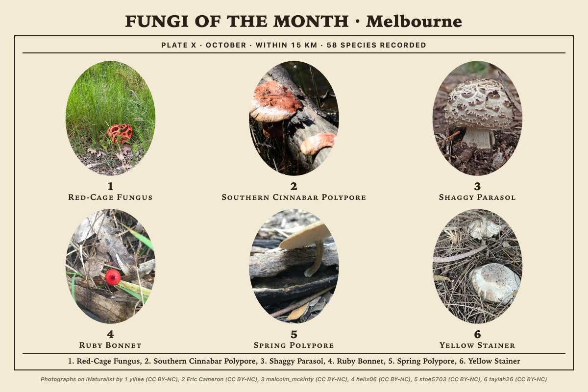
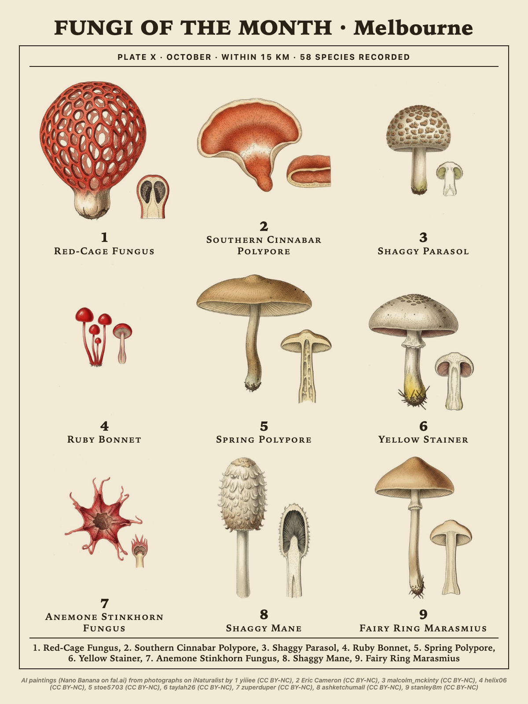
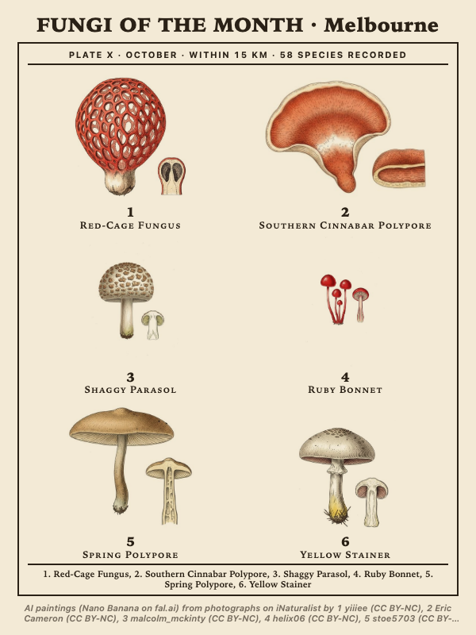
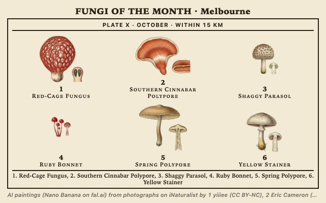
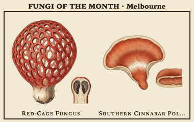
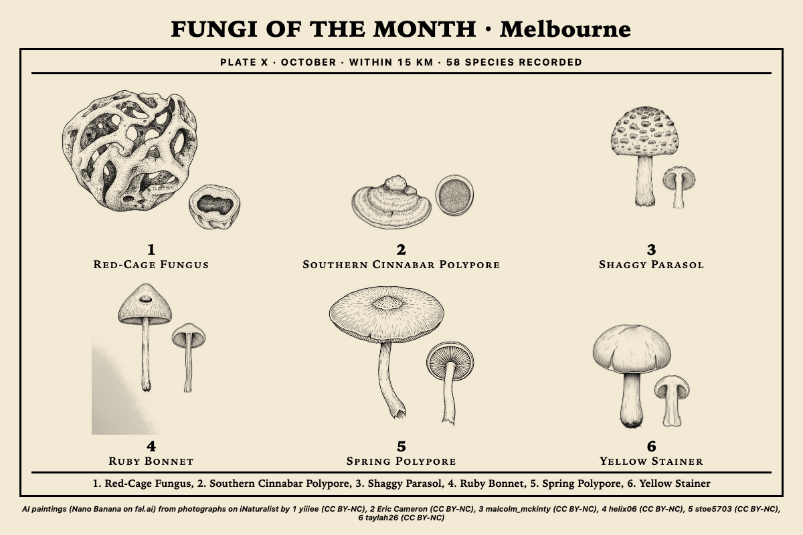
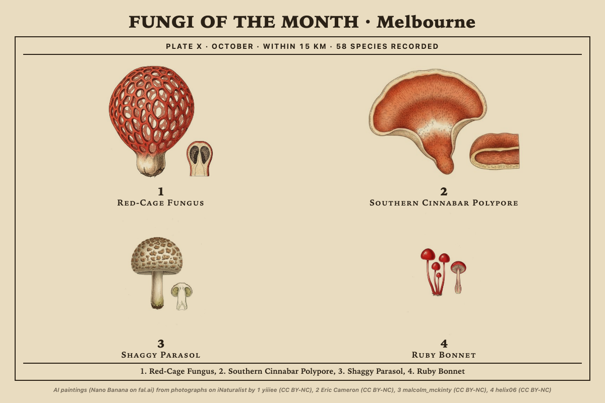
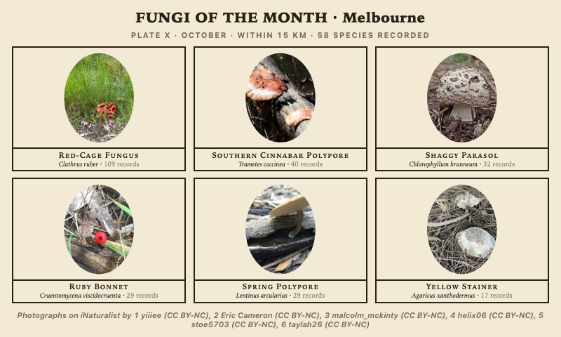

# fungi_plate

The fungi recorded round the panel this month, as a numbered mycological
plate: each species standing with a small cross-section beside it, a plate
number from the month, and a key at the foot.

*The numbered plate at 1200x800: six species painted as hand-coloured engravings on cream paper.*

## What it shows

The species of fungi people have found within a circle round the place, the
most recorded first, with the name under each and a key at the foot. The plate
number is the month in roman numerals (October is Plate X), so the same cell
turns over through the year. The page is the cell, paper edge to edge.

Two layouts. The **numbered plate** is one ruled frame with the species in a
grid, each numbered in bold with its name in small capitals, and the key line
"1. Ghost Fungus, 2. Ruby Bonnet, ..." at the foot. **Ruled boxes** gives each
species a thin box of its own with a caption bar: the common name, the Latin in
italics and how many records.

*Ruled boxes on white paper: the common name, the Latin and the number of records in each caption bar.*

## Where the data comes from, and its limits

[iNaturalist](https://www.inaturalist.org) observations through its public
API: research grade only (the community agrees on the species), fungi only,
with photographs, and only observations whose photographs carry a Creative
Commons licence (CC0, CC BY, CC BY-NC, CC BY-SA, CC BY-NC-SA, CC BY-ND or
CC BY-NC-ND), so every picture the plate shows or paints from may be reused
with credit. The species are grouped and ranked by the number of such
observations; a species whose only records have unlicensed photos is not on
the plate. Each species carries its most faved observation's photo, who took
it and the licence, and the day it was last seen.

The default window, **This month**, is the calendar month in every year
iNaturalist has, so the plate is seasonal: what fruits here in October, not
what was found this week. **Last 30 days** and **Last 90 days** count back from
to-day. "Within 15 km" is a circle round the place; the records inside it are
whatever people have uploaded, which says as much about where people walk as
about where fungi grow.

The answer is kept six hours in the widget's data folder, and photographs are
fetched once and kept. The widget needs the network at render time and
declares `network:*` (iNaturalist, its photo hosts and fal.ai).

## Pictures

**Photographs** (the default) cost nothing: each species' photo in a soft
oval, with the photographer and licence in the credit line under the plate.

*Photographs: each species' most faved openly licensed photo in a soft oval, with its credit at the foot.*

**AI paintings** paint each species once from that photo through
[fal.ai](https://fal.ai), in the style chosen: a hand-coloured engraving from a
nineteenth-century mycological plate, a watercolour after Beatrix Potter, a
woodblock print, an ink line drawing (good for black and white panels) or a
gouache field guide. The prompt asks for the whole fruiting body in the form
the photo shows (cap and stem, bracket, cup, coral, puffball or crust),
standing on nothing, with a small cross-section of the same fungus beside it,
on plain white paper and nothing else. Each painting is trimmed to its subject
and laid on the paper, and credited "AI painting (Nano Banana on fal.ai) from
a photo by <user> (<licence>)".

Paintings go through Tesserae's own picture store (`app.artwork`, Tesserae
0.463 and later): one painting per species, style and model, kept on disk with
its credit, queued in the background within a daily budget, and listed on the
widget's paintings page under Plugins. A preview in the editor holds its
paintings until the cell is settled; a push, a schedule or a warm-ahead starts
what the page needs, and the plate shows the photographs until each painting
lands. Nano Banana is about US$0.04 a painting, so a plate of six is about a
quarter of a dollar, once. On an older Tesserae the plate shows photographs
and a note says why.

The key goes in this widget's settings (`fal.ai API key`), or the app-level
key under Settings is used. The settings also hold the painting budget per
day (US$2 by default) and how many new paintings a settled preview may start.

*Nine species on a 1200x1600 portrait cell, three by three.*

*Six species on a 600x800 portrait cell (a quarter of a 13.3" panel), two by three.*

## Sizes

Designed for sm, md and lg cells, portrait and landscape, and tall 13.3"
cells. A half panel (md) shows at most six species; a small card (sm) shows
one or two and the title only. Type and rules scale with the cell.

*A 640x400 half-panel cell: the names wrap to two lines where they must, the key still fits.*

*A 380x240 card: two species and the title.*

## Panels

The **Panel** option (under More options) converts every picture for what the
panel can show: colour, 16 greys, 4 greys, or black and white, where the type
is thickened and the rules heavier. Ink line drawing is the style made for a
black and white panel.

*Ink line drawings with Panel set to black and white.*

*Four species on aged paper, two by two.*

*Ruled boxes with photographs on an 800x480 cell, rendered under the dark page theme. The page is paper, so the theme does not change it; Paper does.*

## Options

Window, how many, layout, pictures and paper are always shown; the place and
its radius show for the place source; the style shows for AI paintings; the
rest sit under **More options** (Tesserae 0.473 and later; an older Tesserae
shows them all).

| Option | Notes |
| --- | --- |
| Place | Where to look. Falls back to the app-level location. |
| Within | 2 to 50 km round the place; 15 by default. |
| Window | This month (the calendar month, any year), last 30 days or last 90 days. |
| How many | 1, 2, 4, 6, 8 or 9 species, the most recorded first. |
| Layout | Numbered plate or ruled boxes. |
| Pictures | Photographs, or AI paintings in the style below. |
| Style | Hand-coloured engraving, watercolour after Beatrix Potter, woodblock print, ink line drawing, gouache field guide. |
| Paper | Cream, white or aged. |
| Source | More options. The fungi round the place, or one iNaturalist user's own records, anywhere. |
| iNaturalist username | More options. Whose records, for the user source. |
| Model | More options. Nano Banana (the default), Nano Banana Pro, FLUX.1 Kontext Pro, GPT Image 2 or Seedream 4, all on fal.ai. |
| Panel | More options. Colour, 16 greys, 4 greys or black and white. |
| Title | More options. Blank is FUNGI OF THE MONTH and the place. |
| Credit line | More options. The photographers and licences under the plate; on by default, as the licences ask. |

## Credits and licences

Observations and photographs from [iNaturalist](https://www.inaturalist.org)
and its contributors, each photograph under the Creative Commons licence its
photographer chose; the plate names the photographer and the licence. AI
paintings are made from those photographs through [fal.ai](https://fal.ai)
and are derivative works of them; the credit line says so. Icons from
[Phosphor](https://phosphoricons.com).

Widget code: AGPL-3.0. See [LICENSE](LICENSE).
